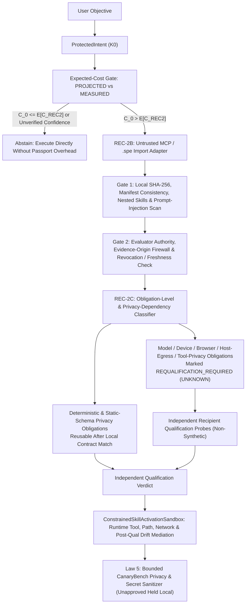

# SPE Ω — REC-2 & REC-2E: Qualified Capability Exchange ("Capability Passport") Architectural Specification

**Status:** Approved Research Specification & Isolated Prototype (`spe_runtime/research/rec2/`)  
**Date:** October 12, 2026  
**Lineage:** Extends `ProtectedIntent`, `WDES`, `CSC`, `LVT`, `Exchange` (`EvidencePassport`), `REC-0` (`ReliabilityEnvelope`), `REC-1` (`RealityTransferEngine`), and `.spe` packaging  
**Release Impact:** Strictly quarantined under `spe_runtime/research/rec2/` and `tests/research/rec2/` (`HOLD` on production release promotion until independent external multi-provider benchmark and `G6-H` human qualification complete).

---

## 1. Repository Custody & Honest Baseline Audit

We audited the exact git repository and multi-worktree state in `/Volumes/4TB-WD/offloaded-mac-storage/home-projects/system-prompt-engine`:

| Subsystem / Proposal | Repository / Branch Custody | Verified Custody State | Implication for REC-2 / REC-2E |
| :--- | :--- | :--- | :--- |
| **REC-2 Local Worktree** | `/Volumes/4TB-WD/offloaded-mac-storage/home-projects/system-prompt-engine` (`repair/discovery-truth` @ `5d7c06f095c90a5c3f6f97404e06d30e3eb534a2`) | Uncommitted isolated prototype in `spe_runtime/research/rec2/` and `tests/research/rec2/` | Preserve all uncommitted worktree changes; do not silently merge branches. |
| **REC-0 Reliability Envelope** | Branch `antigravity/rec0-reliability-envelope` (`0d7ae70a` / `9075da4a`) | Implemented & tested (`spe_runtime/research/rec/`, 15/15 REC-0 tests passing) | Reconcile via `REC0CompatibilityAdapter` (`REC0EnvelopeValidityState`, `REC0DriftTrigger`, 12-field `ReliabilityEnvelope` round-trip) without silent branch merge. |
| **REC-1 Reality Transfer** | Branch `antigravity/rec1-counterfactual-reality-transfer` (`627d8625` in worktree `/Volumes/4TB-WD/spe-worktrees/spe-rec0-reliability-envelope`) | Implemented & tested (`spe_runtime/research/rec/reality_transfer.py`, 6/6 REC-1 tests passing) | Align `EvidenceOrigin` firewall (`SYNTHETIC_CALIBRATION_ONLY` / blocking synthetic fixtures from production `VALID`). |
| **WDES & 2PC NanoUSD Accounting** | [`spe_runtime/research/wdes/`](../../spe_runtime/research/wdes/) | Implemented & tested | Reuse `NanoUSD`, `validate_nanos`, and `PredicateValue` (`TRUE`, `FALSE`, `UNKNOWN`). |
| **Counterfactual Specification Closure (CSC)** | [`spe_runtime/research/csc/`](../../spe_runtime/research/csc/) | Implemented & tested | Reuse counterfactual challenge semantics for local requalification. |
| **Learning-Validity Transactions (LVT)** | [`spe_runtime/research/lvt/`](../../spe_runtime/research/lvt/) | Implemented & tested | [`LearningTransferProtocol.synthesize_spe_learning_artifact`](../../spe_runtime/research/lvt/transfer_protocol.py#L81-L115) defaulted to `supported_models = ("gpt-4o", "claude-3-7-sonnet", "llama-3-3-70b")`. REC-2 closes this via **Law 3 (No Inherited Success)**. |
| **Exchange Evidence Passport** | [`spe_runtime/research/exchange/merit_ranker.py`](../../spe_runtime/research/exchange/merit_ranker.py) | Implemented & tested | Provides single-environment `EvidencePassport` and `SecurityAudit`. REC-2 extends this with obligation-level cross-host transfer qualification. |

---

## 2. Core Problem & Separation of Concerns

Sharing an AI skill across users or hosts is not equivalent to sharing verified capability:
1. **Transport is not trust**: The Model Context Protocol (MCP) Skills specification explicitly notes that skill packages are untrusted content and server-supplied digests are not an independent security boundary.Furthermore, import-time checks alone do not guarantee runtime execution containment if instructions later induce unsafe tool calls.
2. **Skill evolution is not qualification**: Federated skill sharing (`FederatedSkill`, arXiv:2606.03143) shares structured skill updates, and signed skill packages bind identity or static capability limits, but neither establishes whether an imported procedure actually works on a **different foundation model**, **different device**, or **different permission boundary**.
3. **Summarization is not privacy**: `CanaryBench` (`arXiv:2601.18834`) shows that derived summaries and procedures can leak planted secrets, transformed identifiers, or paraphrased sensitive facts from private conversations even when raw transcripts are omitted. Static/heuristic export screening is a **bounded leakage detector**, never a universal proof of comprehensive privacy.

### The Three-Way Separation Invariant
`REC-2` enforces a strict separation between three distinct artifacts:
- **Skill Definition (`How`)**: Declarative instructions, prompt templates, and deterministic schemas describing *how* to perform a procedure.
- **Capability Qualification (`Where & Whether`)**: Scoped empirical and deterministic evidence recording *where* the procedure was tested, *which* independent evaluator attested to the outcome, and *which* obligations remain `UNKNOWN` in a new environment.
- **Execution Authorization (`Permission`)**: Host-enforced capability grants and `ConstrainedSkillActivationSandbox` runtime mediation determining *whether* the receiving runtime permits specific filesystem, network, or tool operations during actual skill activation.

---

## 3. Architecture & State Transition Pipeline

---

## 4. The Eight Engineering Laws of REC-2

| Law | Name | Formal Requirement | Enforcement Mechanism |
| :--- | :--- | :--- | :--- |
| **Law 1** | **Intent Preservation** | $\forall c \in \text{ImportedSkill},\; \text{Constraints}(K_0) \subseteq \text{Constraints}(K_0 \oplus c)$ | Rejects any package whose instructions or tool declarations contradict or weaken `ProtectedIntent` negative constraints. |
| **Law 2** | **Trust Separation** | $\text{HashValid} \not\Rightarrow \text{TrustedEvaluator} \not\Rightarrow \text{AuthorizedPermission} \not\Rightarrow \text{OutcomeValid}$ | Four independent verification stages; passing `sha256` content integrity never grants evaluator trust or elevated permissions. |
| **Law 3** | **No Inherited Success** | $\text{Model}_{\text{source}} \neq \text{Model}_{\text{recipient}} \implies \text{Status}(\text{ModelClaims}) = \text{REQUALIFICATION\_REQUIRED}$ | Evidence qualified on `Model A` cannot produce a verified `Model B` performance claim without passing independent recipient-specific qualification tests. |
| **Law 4** | **Recipient-Specific Obligation Validity** | Package claims are decomposed into atomic obligations $O = \{o_1, \dots, o_k\}$ classified by scope and privacy dependency | Deterministic schema obligations transfer upon contract verification; host-egress privacy, model-tool privacy, browser, GPU hardware, and provider-API obligations require matching dependencies or local measurements. |
| **Law 5** | **Bounded Privacy Screening & Local Hold** | Threat-model-bounded detection of raw transcripts, credentials, planted canaries, encoded secrets, transformed identifiers, paraphrased facts, and multi-step splits; unknown/unapproved fields held local | `CanaryBenchPrivacyExporter` enforces a strict schema allowlist, decodes Base64/Hex/URL/ROT13/reversed payloads, checks truncated/transformed IDs and content-stem paraphrases, and sets `comprehensive_privacy_proven = False`. |
| **Law 6** | **Revocation, Distribution Shift & Offline Freshness** | Explicit passport/oracle/evidence revocation or distribution shift $\Delta d > \tau$ blocks reuse immediately; offline operation enforces $\Delta t \le H_{\max}$ | Risk-sensitive capabilities fail closed (`STALE_OFFLINE_REVOCATION_HORIZON` / `REVOKED` / `REQUALIFICATION_REQUIRED`). |
| **Law 7** | **Import & Runtime Execution Containment** | Importing executes **zero** code; activating a skill mediates all tool calls inside `ConstrainedSkillActivationSandbox` | `UntrustedMCPImportAdapter` blocks hooks, prompt-injection directives, modified manifests, and escalated nested skills; `ConstrainedSkillActivationSandbox` blocks unauthorized runtime tool calls, path traversal, egress, and post-qualification permission/authority drift. |
| **Law 8** | **Expected-Cost & Evidence-Class Gate** | Distinguishes `PROJECTED_COST_ADVANTAGE` from `MEASURED_COST_ADVANTAGE` across cold-start and repeat-use horizons in integer `NanoUSD` | Accounts for import, validation, rejection, repair, qualification, execution, verification, and failure recovery; requires empirical Wilson lower bounds and independent quality/safety verification before `production_qualified = True`. |

---

## 5. Granular Obligation & Privacy Requalification Matrix (`REC-2C`)

| Obligation Scope / Privacy Sub-Type | Example Claim | Transfer Rule on Recipient Host |
| :--- | :--- | :--- |
| `DETERMINISTIC_CONTRACT` | JSON schema generation | **Directly Reusable** after local deterministic contract hash, content hash, and independent oracle checks pass. |
| `DATA_PRIVACY_BOUNDARY` (`STATIC_SCHEMA_INVARIANT`) | Serialized output contains no `raw_conversation` field | **Directly Reusable** only if `deterministic_contract_hash` matches recipient contract and authority/hash are valid. |
| `DATA_PRIVACY_BOUNDARY` (`HOST_PERMISSION_AND_EGRESS_INVARIANT`) | Zero external network egress or credential access | **Requalification Required (`UNKNOWN`)** if host changes, network policy widens, tool surface changes, execution controls are disabled, or distribution shift exceeds tolerance. |
| `DATA_PRIVACY_BOUNDARY` (`MODEL_AND_TOOL_BEHAVIOR_DEPENDENT`) | Model tool-call parameter redaction | **Requalification Required (`UNKNOWN`)** whenever `recipient_model_id != source_model_id` or host/network/tools differ. |
| `BROWSER_DOM_ACCESSIBILITY` | Keyboard navigation & `prefers-reduced-motion` | **Requalification Required (`UNKNOWN`)** if browser engine, model, or DOM harness differs. |
| `DEVICE_HARDWARE_PERFORMANCE` | 60 FPS GPU shader / animation budget | **Requalification Required (`UNKNOWN`)** on different recipient GPU/SoC hardware or model. |
| `PROVIDER_API_TOOL` | Model-specific tool-call formatting | **Requalification Required (`UNKNOWN`)** whenever `recipient_model_id != source_model_id`. |

---

## 6. Lifecycle Cost Model: Cold-Start vs Repeat-Use (`Finding D`)

All costs are represented in exact integer `NanoUSD` ($1\text{ USD} = 10^9\text{ NanoUSD}$):
- One-time setup cost: $C_{\text{setup}} = C_{\text{import}} + C_{\text{validate}} + C_{\text{reject}} + C_{\text{repair}} + C_q$
- Per-use operating cost: $C_{\text{op}}(p) = C_r + C_{\text{verify}} + \lceil (1 - p) \cdot C_f \rceil$
- **Cold-start expected cost ($k = 1$)**: $E[C_{\text{cold}}] = C_{\text{setup}} + C_{\text{op}}(p)$
- **Repeat-use expected cost per verified task ($k \ge 1$)**: $E[C_{\text{repeat}}(k)] = \lceil C_{\text{setup}} / k \rceil + C_{\text{op}}(p)$
- **Conservative uncertainty-bounded cost**: Evaluated at the 95% Wilson lower bound $p_{\text{lower}}$ rather than point estimate $\hat{p}$.
- **Evidence Classification**:
  - `PROJECTED_COST_ADVANTAGE`: Calculated from assumed/example inputs or local synthetic fixtures (`production_qualified = False`).
  - `MEASURED_COST_ADVANTAGE`: Established from matched workload executions with empirical Wilson confidence bounds and independent outcome verification.
  - `UNVERIFIED_CONFIDENCE_REJECTED`: Rejects probabilities derived from model verbal confidence or self-assessment.

---

## 7. REC-2E Qualification Matrix & Claim-by-Claim Qualification Ledger

| Claim ID | Claim Description | Current Evidence Status | Production Promotion |
| :--- | :--- | :--- | :--- |
| `CLAIM-REC0-CUSTODY` | `REC-0` implementation on `antigravity/rec0-reliability-envelope` (`0d7ae70a`) & `REC-1` on `antigravity/rec1-counterfactual-reality-transfer` (`627d8625`) reconciled via `REC0CompatibilityAdapter` | `VERIFIED_ON_BRANCH_ANTIGRAVITY_REC0_RELIABILITY_ENVELOPE` | `False` (`HOLD`) |
| `CLAIM-P0-SECURITY-CONTAINMENT` | Import-time + `ConstrainedSkillActivationSandbox` runtime mediation (prompt injection, nested skills, modified manifests, revoked authorities, post-qual permission drift) | `VERIFIED_IN_CONSTRAINED_SANDBOX_PROTOTYPE` | `False` (`HOLD`) |
| `CLAIM-P0-PRIVACY-BOUNDARY` | Bounded leakage detector (canaries, credentials, Base64/Hex/URL/ROT13, transformed IDs, paraphrased facts, multi-step splits, unapproved field local hold) | `BOUNDED_DETECTOR_VERIFIED_UNIVERSAL_PRIVACY_NOT_PROVEN` | `False` (`HOLD`) |
| `CLAIM-P0-EVIDENCE-INTEGRITY` | Granular privacy obligation transfer & Evidence-Origin Firewall blocking synthetic/caller/self-report promotion from `UNKNOWN` to `PASS` | `VERIFIED_LOCAL_FALSIFICATION_SUITE` | `False` (`HOLD`) |
| `CLAIM-P1-COST-ADVANTAGE` | 12.82× single-use / amortized repeat-use cost calculations | `PROJECTED_COST_ADVANTAGE_ONLY` | `False` (`HOLD`) |
| `CLAIM-RELEASE-GATE` | External multi-provider qualification, `G6-H` human evaluation, and production release | `HOLD` (`PENDING` external multi-provider run) | `False` (`HOLD`) |
